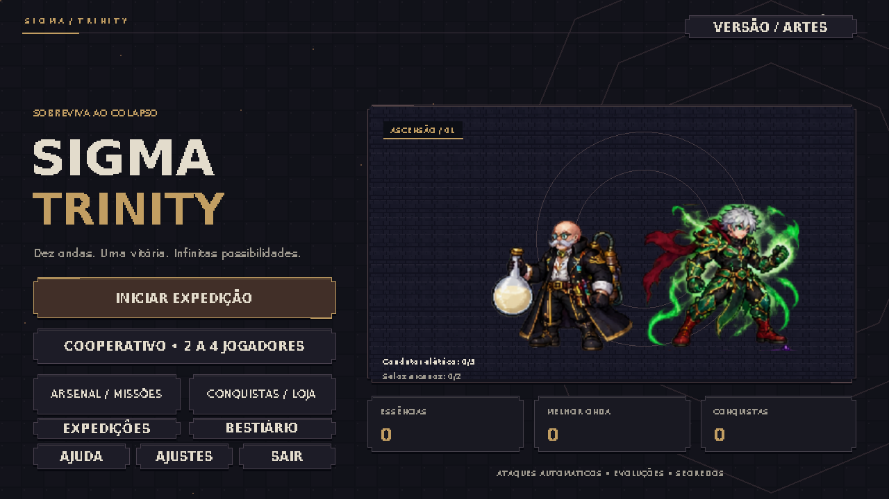
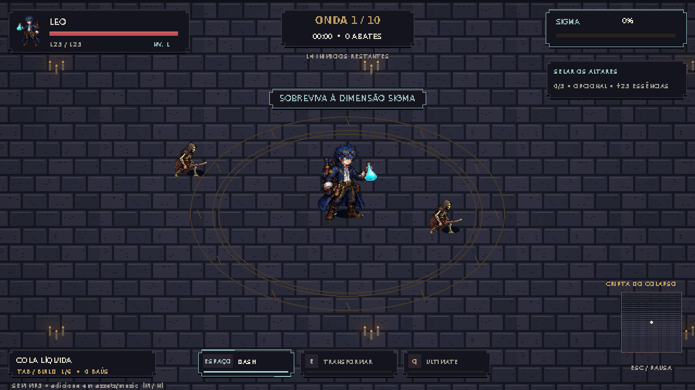

# SIGMA TRINITY — Projeto Python

Jogo 2D de sobrevivência por ondas, desenvolvido em **Python e Pygame**, para
entretenimento e estudo de programação. O jogador escolhe um personagem, enfrenta
inimigos com ataques automáticos, escolhe melhorias e enfrenta o chefe na onda 10.
Depois da vitória, pode continuar em ondas infinitas.




## Participantes

Projeto em trio:

- Leonardo Cardoso Fraiolli
- Wendell
- Davi Ribeiro

## Requisitos

- Python **3.11 ou superior**; validação desta entrega em Python 3.12.
- Pygame, instalado por `requirements.txt`.
- Windows ou Linux com interface gráfica para jogar.
- Não precisa de chave de API. Funciona offline depois da instalação.

## Instalação e execução

Baixe ou clone o repositório e abra um terminal na pasta que contém `main.py`.

No Windows:

```console
py -m venv .venv
.venv\Scripts\python -m pip install -r requirements.txt
.venv\Scripts\python main.py
```

Se `py` não existir, use `python` na primeira linha. Depois da instalação, também
é possível abrir `JOGAR.bat`, que procura o ambiente `.venv` primeiro.

No Linux:

```console
python3 -m venv .venv
.venv/bin/python -m pip install -r requirements.txt
.venv/bin/python main.py
```

## Controles

| Tecla | Ação |
|---|---|
| WASD ou setas | Movimentar; ataques são automáticos |
| Espaço | Esquiva/dash |
| E | Transformação quando a barra Sigma está completa |
| Q | Ultimate durante a transformação |
| Tab | Consultar a build |
| F | Alternar Ego/Vínculo na última evolução de Musashi |
| Esc | Pausar |
| Enter | Confirmar uma opção ou pular cutscene |

## Funcionalidades

- 15 personagens, dois deles secretos, com kits e progressões diferentes.
- Seis arenas, monstros próprios e chefes com fases e ataques sinalizados.
- Melhorias durante a partida, moedas, conquistas, missões e upgrades permanentes.
- Artes em pixel art, animações, efeitos e cutscenes.
- Cooperativo opcional para até quatro jogadores por LAN/Radmin VPN.
- Salvamento local automático em `save.json`, que não deve entrar no GitHub.

O modo solo é suficiente para executar e avaliar o projeto. Cooperativo requer
que todos usem a mesma versão e tenham rede/firewall configurados; consulte
`MULTIPLAYER.md`. Não depende de um servidor hospedado ou de serviços pagos.

## Organização do código

| Arquivo/grupo | Responsabilidade |
|---|---|
| `main.py` | Entrada, argumentos e inicialização |
| `game.py` | Estados, eventos, menu e loop principal |
| `session.py`, `entities.py` | Simulação e entidades de combate |
| `weapons.py`, `ascension.py`, `legends.py`, `evolution_kit.py` | Ataques, evoluções e habilidades |
| `waves.py`, `maps.py`, `boss_patterns.py` | Ondas, arenas e chefes |
| `renderer.py`, `ui_screens.py`, `ui_design.py`, `pixel_ui.py` | Desenho e interface |
| `save_manager.py`, `progression.py` | Persistência e progressão |
| `netcode.py`, `multiplayer.py`, `netstate.py` | Comunicação TCP e sincronização |
| `assets/` | Imagens, fontes e efeitos sonoros necessários |
| `*_test.py`, `self_test.py` | Testes automatizados |

O manual completo está em `README_JOGO.md`. O passo a passo da entrega está em
`COMO_ENTREGAR.md`.

## Verificação

```console
python main.py --diagnose
python main.py --headless --character leo --frames 180
python main.py --self-test
```

Use o Python do ambiente virtual, como nos comandos de instalação. `--headless`
executa sem janela; `--self-test` pode levar alguns minutos. A validação e seus
limites estão em `VALIDACAO_ENTREGA.md`.

## Artes, IA e uso educacional

Projeto desenvolvido com auxílio de IA na implementação, revisão e geração de
artes. Esta cópia de entrega substitui as fotos dos personagens originais por
**avatares fictícios gerados por IA**, sem usar fotos como referência, e não inclui
saves pessoais nem músicas enviadas pelos jogadores. Os prompts ficam em
`assets/art/`. A IA não é chamada durante a execução.

Há personagens inspirados em obras de terceiros. É um projeto de fãs para estudo,
sem associação oficial às obras. As fontes DejaVu têm licença incluída em
`assets/fonts/LICENSE_DejaVu.txt`. Não se concede licença sobre obras de terceiros.

O `.gitignore` exclui ambientes locais, saves, logs, credenciais e músicas pessoais.
O `.gitattributes` preserva os bytes dos arquivos ao clonar no Windows/Linux,
evitando que a conversão automática de quebras de linha invalide o manifesto.
Mantenha código e assets desta entrega juntos: o manifesto verifica integridade
para detectar instalações incompletas. Se alterar código ou arte intencionalmente,
execute `python atualizar_manifesto.py` antes de testar a instalação.
